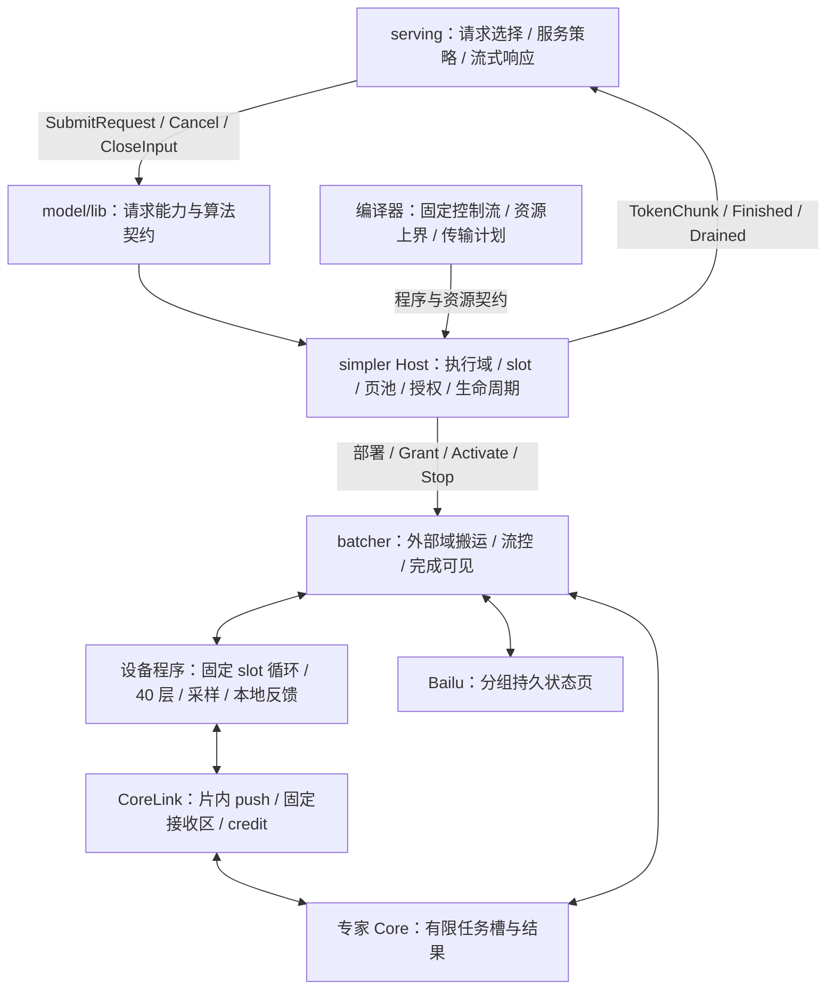
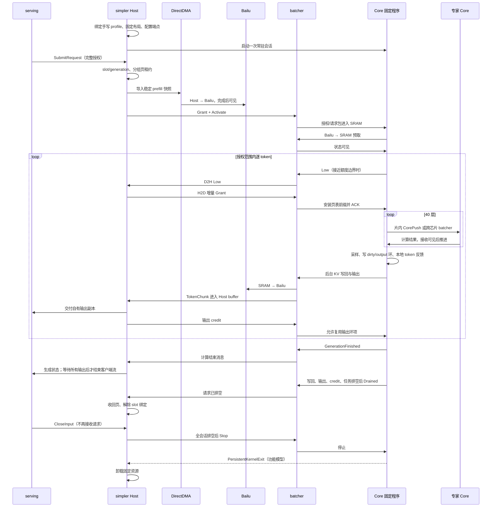

# Megakernel + Persistent Kernel 下的完整 Decode 组件推演

日期：2026-11-25。[内存、硬件预算与验证结果](./resources-and-validation.md)。配套为[可执行仿真](../../../examples/wse/persistent_decode/request_service/README.md)、[完整请求输入](../../../examples/wse/persistent_decode/request_service/requests.json)和[运行证据](../../../examples/wse/persistent_decode/request_service/evidence/validation.json)。

本轮把 serving 的授权单位改为**完整、有界的生成请求**，设备在一个常驻会话中完成多层计算、采样和 token 反馈。正常回放一次启动，3 个请求复用 2 个 slot，生成 8 个 token，执行 320 层；7 个场景及 12 项保护检查通过。核心变化是：**serving 决定服务哪些请求、允许生成多少；Host simpler 管执行域和物理资源；固定设备程序在授权范围内推进计算；batcher/通信硬件保证数据交接。**

这是新增的请求级功能原型。当前产品仍以 `StepCommand` 和 serving `KvCacheManager` 为基线。本原型明确把物理页池管理权移给 Host simpler，避免两个分配权威；它没有直接接入真实 serving、simpler Worker 或 PyPTO codegen。

## 1. 组件、部署与边界



图表示目标组件归属。代码中 `ModelAdapter.lower()` 在 `SimplerHost.submit()` 内调用，以缩小原型；生产代码应保留模型适配边界。编译器这一格是**待接入项**：本次手写 `DeviceSlot` 固定状态转移，模拟编译结果，未实际编译模型。`PROGRAM_PROFILE_BOUND` 仅说明选定了该手写 profile。

| 顶层组件 | 本次承接的职责 | 本次代码落点 |
| -------- | -------------- | ------------ |
| serving | 接收有限请求、选择提交次序、遇满队列继续持有请求、取消、token 流与最终通知 | `model.py: Serving` |
| model/lib | 确认 sampling、上下文、生成上限、分组契约，定义计算与停止语义 | `ModelAdapter`、`oracle`、设备固定计算 |
| 编译器 | 目标上产生有限控制流、SRAM 布局与通信模板 | 本次由手写 `Layout/DeviceSlot` 代替 |
| simpler Host | 部署、唯一物理页池、slot/generation、续额、控制包、输出交付、排空和卸载 | `SimplerHost/CachePool/Layout` |
| AICore 上的模型程序 | 有限状态、依赖等待、40 层、专家任务、采样、反馈、环管理 | `device.py` |
| batcher / CoreLink / DirectDMA | 接受传输、占用资源、复制 payload、发布可见、归还责任 | `transport.py` |

Host simpler 是一个进程内对象，不另起服务进程。本例一个 Host 执行域管理两颗逻辑芯片，各 8 个 Core；slot 0/1 的 home 分别为 Core 0/8。路由专家放在 Core 1、2、3、4、9、10、11、12，共享专家放在各 home 的 Core 5/13。两个请求可能竞争专家和传输服务；没有模拟多 Host 或跨超节点。

**Megakernel**在这里指设备固定程序覆盖一个 token 的全部层及采样；**persistent**指同一程序实例继续处理后继 token 和新请求。Core 上没有通用任务图 runtime、动态分配器或任意算子解释器；等待、分支和 credit 检查都是有限程序的一部分。Python 状态机是这一控制流的功能模型。

## 2. 编程界面和本次请求

实际可执行入口读取 `requests.json`，其中 A 的请求如下；B、C 具有相同字段。serving 调用 `SimplerHost.submit(spec)`，后续不发送逐 token `StepCommand`，也不传物理 block IDs。

```json
{
  "request_id": "A",
  "prompt_context": 127,
  "seed": 11,
  "max_new_tokens": 4,
  "eos_token_id": 25,
  "sampling": "scalar_mod97",
  "policy_epoch": 1,
  "cache_groups": ["window", "c2a", "c1a"]
}
```

| 请求 | 已有 context | 输入 seed | 最多生成 | EOS | 本次结果 |
| ---- | ------------ | --------- | -------- | --- | -------- |
| A | 127 | 11 | 4 | 25 | 61、25，EOS 停止 |
| B | 255 | 18 | 4 | 无 | 0、59、47、23，长度停止 |
| C | 127 | 97 | 2 | 无 | 39、66，长度停止；等待后复用 A 的 slot |

`seed` 是预填充后首个 decode 输入的标量替身，导入状态的 `history=5` 也是缩比数据。请求 context 决定容量边界；整数数学使用生成序号，未实现实际 position embedding 或完整历史 attention。`scalar_mod97` 是本实验采样语义；`top_p` 等能力不支持时直接拒绝，不能静默降级。

本 profile 固定 2 个 slot、最大 context 512、每请求最多 6 个新 token；容量可续额，物理 buffer 不在运行时新增。超过 profile 需重新准备合适程序/资源，本实验没有实现跨 profile 状态迁移。

## 3. 从部署到完整请求执行



`CloseInput` 可以在已接受最后一个请求时提前发生；它不取消正在执行的请求。图中的 `PersistentKernelExit` 是模拟器的会话级确认，真实多芯片仍需要各端点退出/栅栏汇聚，不能用 home 0 的单次通知代替。

### 3.1 部署和导入：谁准备、谁能开始

**[model/lib + 编译器模型]** 选定固定 40 层流程、两组通信 bank、固定专家映射、请求参数能力和内存上界。真实权重没有加载；设备计算中的整数常量代替模型参数。

**[simpler Host]** 在 launch 前创建 246 个固定内存项，封存布局；记录 8 个 batcher endpoint 的预算。启动一次设备会话，之后只绑定预置 slot 和页租约，不在 Core 侧 malloc。这里的部署是 Python 内存/控制模型，不是驱动向真实芯片写入 binary。

**[simpler Host + DirectDMA]** 接受 A、B；C 无空闲 slot，仍由 serving 排队。按已有 context 为 A 分配 window/C2A/C1A 页数 1/1/1，为 B 分配 2/1/2。把 Host 的稳定快照复制到各组 Bailu 页，等全部 `PREFILL_PART_VISIBLE` 后才允许激活。

**[batcher + Core]** 将 Grant 和 Activate 包搬到 SRAM；Core 安装本 generation 的页表及授权。第一次读取历史经 Bailu→batcher→SRAM；`REQUEST_ACTIVE` 之后才计算。Grant 可以先到，固定状态等待匹配的 Activate；不能把 Host 的账本直接当作 Core 已看见的数据。

### 3.2 一个实际 token：计算、通信和本地反馈

**[Core home 0]** A 的第一个 token 从 `last=11、history=5` 得到 `hidden=16`。第 0 层求 `x=(3×16+1+0) mod 1000003=49`，选择路由专家 `[1,2,3,4,5,6]` 和共享专家 8。每个专家返回 `(x×(expert+2)+17×layer+expert) mod 1000003`；home 按 lane 权重合并，得到 `hidden=10143`，实际 trace 在 tick 65 提交该层。

**[CoreLink / batcher / ExpertCore]** A 的前三个路由目标在同片 Core 2/3/4，经预置接收区 push；其余在另一芯片，经 batcher 外部通路；共享专家在 Core 5。片内第一条输入 tick 43 注入、tick 45 可见，接收端可推进，不等待原发送端收到整轮 ACK。专家读取后计算，结果回到 home 的固定 result 区，7 个结果到齐后提交本层，再进入下一层。输入 payload credit 和结果 credit 按最后使用分别归还，通信 buffer 不因“DMA 已读”就提前复用。

**[Core 固定程序]** 40 层完成后 A 的 hidden 为 272146，采样 `272146 mod 97=61`，tick 1093 写入 dirty/output 环。下一 token 直接读取 SRAM 中最新 hidden 和 token，生成 25 并因 EOS 停止。完整路径没有逐层 Host 调度，也没有逐 token serving 许可往返；容量续额、输出和取消仍使用 Host 通路。

### 3.3 KV 续额：容量动态增长，计算授权仍有上界

**[Core]** 在 token 开始前验证 `prompt_context+sequence <= authorized_context`。剩余额度不超过 1 且尚未覆盖完整请求预算时，通过 batcher 发 `Low(key, claimed_context)`；每个 grant epoch 至多触发一次。缺额时停在下一 token 起点，不能写未授权页。

**[simpler Host.CachePool]** 收到 Low 后，为三个 group 原子预留到 `min(claimed_context+2, prompt_context+max_new_tokens)` 的容量，保留既有页表前缀；发送新 Grant，并等 GrantAck。B 从 context 256 跨到 257 前，页数由 2/1/2 扩至 3/2/3。本次 tick 64 已安装 context 258 的授权；tick 1166 扩至 259，后一次只扩使用额度，不新增物理页。

因此每个 slot 不按最大 context 512 独占全部 KV 页；**物理页池预分配，具体请求按已有状态和续额领取页租约。**页表、环项和通信区的最大大小预先固定。这里 128/256/128 是各组源 token 的容量阈值，每页仅保存 128B 标量快照，不代表真实 KV 字节数或压缩尾部有效性。

**[Core + batcher]** 最新状态驻 SRAM；写回保持源稳定，直到相应组数据在 Bailu 可见才释放 dirty 项。基础场景刻意延迟 B 的第一批写回到第二个 token 已提交，以验证计算可以使用 SRAM 最新版本。dirty 环只有两项，第三个 token 遇满必须等待，不能无限积压。

### 3.4 输出、结束、回收与复用

**[batcher → simpler Host → serving]** token 由 SRAM 经 batcher 到 Host 输出区；Host 根据 `HOST_OUTPUT_VISIBLE` 读取并交付副本，再通过 H2D credit 允许 Core 复用输出项。客户端网络发送无需成为设备 buffer 的最后拥有者；Host 自有队列满时仍向设备传播背压。

**[serving]** `GenerationFinished` 只报告设备不再生成。A 的结束状态 tick 2094 到达 serving，最后一个 token 的副本 tick 2097 才交付，故 serving 必须等 `emitted` 个输出均已取得、待发送队列清空后，才发 `CLIENT_GENERATION_FINISHED`。这条顺序已写入断言。

**[Core + simpler Host]** Core 等 dirty、output、专家任务、payload credit 和本请求传输排空，再 D2H 发 Drained。Host 接到消息，确认 grant 事务及传输责任结束，才归还所有分组租约并解除 slot。tick 2113 A 被回收，2114 C 以 `C:2` 复用 slot 0；旧 `A:1` 的 credit 不能作用到它。

**[simpler Host + Core]** 全部请求回收且 CloseInput 已到达，形成 `SessionDrained`；随后发 Stop，确认 persistent 程序退出，再卸载固定资源。请求结束、请求排空、会话排空、kernel 退出、卸载是五个不同边界。
