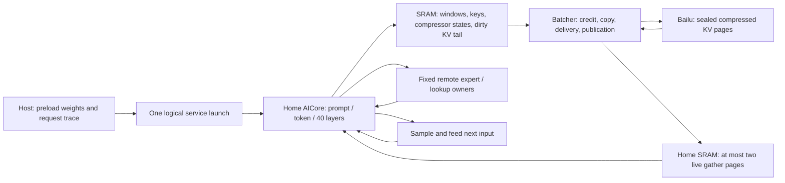

# Programmable persistent decode simulation

This source-tree C++ simulator executes a complete scaled decode flow in the
WSE logical backend. It runs actual dense numeric operations, processes the
prompt, feeds sampled tokens back into the device service, drains KV writes,
and retires requests. Its program image is configurable before service launch.

It is a **scaled structural fixture**, with synthetic deterministic weights.
It does not validate a DeepSeek checkpoint, native batcher instructions, the
ordinary Worker/HBG path, a physical mesh, or chip performance.

## Run and inspect

Prerequisites: Linux or WSL, a C++17 compiler, CMake >= 3.16, and Python >= 3.9.
From the repository root, create the isolated test environment if needed:

```bash
python3 -m venv --system-site-packages .venv
.venv/bin/python -m pip install numpy
bash examples/wse/persistent_decode/run.sh
```

From PowerShell in the repository root, the existing Ubuntu WSL installation
can run the same script:

```powershell
wsl -d Ubuntu-26.04 -- bash examples/wse/persistent_decode/run.sh
```

The standalone CMake target builds its sources directly. It does not use a
previously installed simpler wheel. The ordinary Python Worker path retains
its existing package installation requirements.

`run.sh` builds a Release binary and runs both CTest entries: protocol checks,
then eight numerical scenarios and three expected failures. Outputs are in
`build/wse-persistent/validation/`:

| File | Meaning |
| --- | --- |
| `validation.json` | All numerical and rejection scenario checks |
| `single/results.json`, `multi/results.json` | Tokens, logits, layer checksums, final KV/key/window/state, region peaks |
| `single/events.jsonl`, `multi/events.jsonl` | One event per transfer stage or request observation point |
| `single/programs.json`, `multi/programs.json` | Request AICore, expert/lookup service, and batcher instruction images |
| `single/checks.json`, `multi/checks.json` | Independent NumPy comparison and lifecycle assertions |

Individual runs use the same binary:

```bash
build/wse-persistent/wse_decode_sim --single --output build/decode-single
build/wse-persistent/wse_decode_sim --multi --output build/decode-multi
build/wse-persistent/wse_decode_sim --single --custom-core --output build/decode-custom
build/wse-persistent/wse_decode_sim --multi --custom-batcher --output build/decode-batcher
.venv/bin/python examples/wse/persistent_decode/reference.py build/decode-multi
```

## Program and execution contracts

The [program interface](../../../src/wse/runtime/persistent/program.h) uses POD
instructions `(kind, operation, argument)` and a resumable program counter.
`Invoke`, `Jump`, and `Halt` are interpreted by `Continuation::step()`.
An operation returns `Progress`, `Waiting`, or `Halted`; waiting preserves its
program counter and lets other actors make progress. Programs and operation
registries are installed before `run()`.

| Actor | Installed with | Default operations |
| --- | --- | --- |
| Request AICore | `set_core_program()` | 10 embed, 11 prepare/lookup, 12 index, 13 gather, 14 attention, 15 router, 16 dispatch, 17 combine, 18 advance layer, 19 sample |
| Expert/lookup AICore | `set_service_program()` | 30 compute at the fixed weight/table owner, 31 send result |
| Batcher endpoint | `set_batcher_program()` | 1 acquire destination credit, 2 submit copy, 3 await delivery, 4 publish notification |

For example, an AICore extension can transform the four-stream hidden state
before LM-head sampling:

```cpp
DecodeSimulation simulation;
auto image = default_core_program();
image.name = "decode_with_head_transform";
image.code.insert(image.code.begin() + 9, {InstructionKind::Invoke, 100, 0});
simulation.register_core_operation(100, [](Values &streams) {
    for (auto &value : streams) value += 0.125;
});
simulation.set_core_program(std::move(image));
simulation.add_request({"request", 0, 0, {1, 4, 7}, 4, "", 0});
simulation.run();
```

The executable's `--custom-core` case uses a nonuniform head transform, and its
independent reference validates the changed logits. `--custom-batcher` inserts
a registered generation-check operation before the transport program. The
changed program executes on every transfer and preserves the numerical result.
Invalid batcher publication and service send-before-compute are rejected.

Programmability here means C++ registered operations plus replaceable instruction
images. It is not PyPTO DSL lowering, arbitrary native ELF loading, or hot
replacement of a running program. Custom batcher callbacks inspect their own
message and return a step result; transport capabilities stay in built-in
operations. Core callbacks currently operate on the request's hidden streams.
The expert service image can sequence its built-in compute/send operations.

The logical engine round-robins core services, requests and batcher endpoints.
It models no Host/AICPU dynamic graph scheduler. One finite request trace uses
one logical service launch, with no per-token Host launch. It does not launch
a native persistent Block through the existing Worker backend.

## Model, placement and KV flow

The fixture has 40 layers, hidden width 16, latent width 8, two heads, eight
routed experts, top-6 plus one shared expert, and vocabulary 32. The layer
sequence includes sliding-window attention, C2A sources 2/8/14, C1A source 20,
reuse, reindex layers 24/28/32/36, four-stream HC, RoPE, reduced Engram lookup,
MoE, normalization and greedy sampling. Each input position traverses every
layer. The reduced formulas are fixture semantics, not an exact checkpoint
implementation of the named architecture.

Two logical chips each contain eight cores and four batcher endpoints. A pair
of cores shares an endpoint. On each chip: core offset 0 owns attention and
request state, offsets 1–4 own four routed experts, offset 5 owns the shared
expert, and offset 6 owns a hash table shard. Weights and tables are loaded
before service launch. Each request has a fixed home chip; top-6 dispatch
necessarily crosses chips. Placement is static; selected experts, selected KV
rows, request lengths, and message readiness are dynamic.



The prompt runs as causal streaming prefill on the same service. At the last
prompt position, the initial sampled token is recorded as `prefill_next_token`.
Pending prefill transfers drain before `PREFILL_READY`. Each configured
`decode_inputs` pass then processes the current token and samples its successor.
Thus the final sampled token has no KV until another input pass processes it.

KV lifecycle:

1. Attention preparation writes the layer's ring window and updates C2A state.
   Sources 2/8/14 publish one compressed row per pair of input positions; source
   20 publishes one per position. Reuse/reindex layers share those four sources.
2. The request home allocates a four-row tail page in SRAM and a key page in
   SRAM. KV and key bytes are written before `ROW_COMMITTED` increments validity.
3. A full page is sealed. The batcher sends its tail to the home chip's Bailu.
   The SRAM tail remains authoritative until delivery and directory publication.
   Source leases prevent reclamation while a queued or active read uses it.
4. The index scans keys at the home and chooses compressed row IDs. Gather
   deduplicates pages, stages selected pages through the batcher, and extracts
   chosen rows after publication. There are at most two live gather buffers.
   Attention reads the local window plus the gathered compressed rows.
5. Finish flushes partial tails. Retirement waits for store completion and all
   request transfers, snapshots the verification state, and reclaims pages,
   keys, windows, states and scratch allowance. Reuse increments slot generation.

Long-term KV uses packed E2M1 FP4 nibbles with an **int16 exponent per four
elements**. This deliberately simple fixture scale format differs from the
full model's hardware cache format. Arithmetic, windows, states and weights are
FP64. Allocations charge 128-byte alignment. SRAM ownership, capacity, DMA
leases, publication order and mailbox credits are enforced. Bailu is not
directly readable by compute operations.

The simulator accounts allocations in 16 MiB/core SRAM, 64 MiB/chip Bailu and
64 KiB/endpoint batcher regions. Batcher descriptors and request scratch use
fixed allowances; C++ actor objects, extracted working vectors and verification
snapshots are host-side simulator storage. These peaks are fixture diagnostics,
not a complete physical placement or metadata capacity certificate.

## Scenarios and remaining scope

Single request A has seven prompt inputs and four decode inputs. Multi-request
A/B start together with prompt lengths 7/13; C1 enters a different slot after
A's second output; C2 reuses A's slot only after A drains. C1/C2 have prompt
lengths 3/5 and two decode inputs each. Multi-request output includes 12 decode
successors. Cancellation stops B at a completed token boundary.

The independent NumPy reference has dense history arrays and no page map or
simulated transport. Checks compare sampled tokens, logits, every layer's
checksum, compressed KV/key rows, all layer windows and C2A state rings. Trace
checks require every transfer to pass send, copy, delivery, publication and
consume in order. Reverse endpoint stepping, one-credit backpressure and a
custom batcher program must preserve results. A modified AICore program must
change logits. Maximum-context tests accept total length 11 and reject that
request when the limit is 10 (the A request needs 7 + 4 = 11).

Still outside this executable: full 144-core/chip geometry, four PE execution
within a core, 2D mesh routing/link contention, maximum-million-token capacity,
pregranted page-pool quotas, external prefill snapshot ingestion, arbitrary
in-flight cancellation/fault recovery, strict-versus-grouped strategy comparison,
native Worker/HBG integration, full checkpoint numerical validation and
calibrated chip timing. Logical ticks represent ordering only.

Implementation entry points:

- [Decode state machines and numerical fixture](../../../src/wse/runtime/persistent/decode.cpp)
- [Memory ownership, transport and batcher interpreter](../../../src/wse/platform/sim/persistent/device.cpp)
- [Programmable interfaces](../../../src/wse/runtime/persistent/decode.h)
- [Executable and program replacement examples](decode_sim.cpp)
- [Independent reference](reference.py) and [scenario runner](run_checks.py)
- [Protocol tests](../../../tests/ut/cpp/wse/persistent/device_test.cpp)
